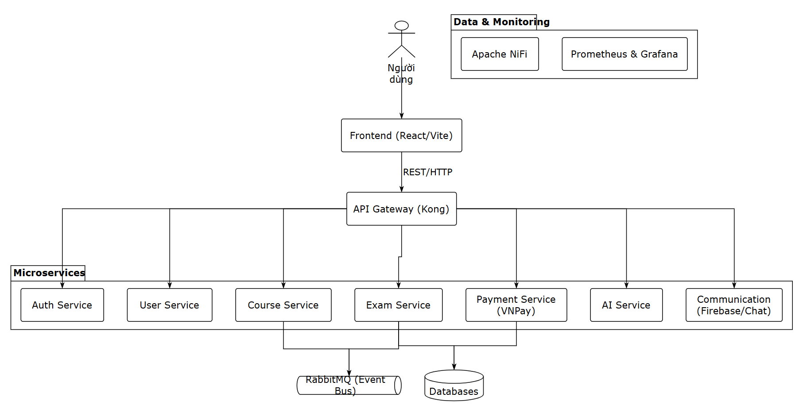

# IGCSE Learning Hub

Nền tảng học tập trực tuyến dành cho học sinh và giáo viên IGCSE. Hệ thống được xây dựng theo kiến trúc microservices, hỗ trợ quản lý người dùng, khóa học, bài thi, thanh toán, giao tiếp và phân tích kết quả học tập bằng AI.

## 1. Giới thiệu

IGCSE Learning Hub cung cấp môi trường học tập trực tuyến, trong đó:

- Học sinh có thể tham gia khóa học và làm bài thi.
- Giáo viên có thể tạo, cập nhật và quản lý khóa học.
- Quản trị viên có thể xét duyệt khóa học và quản lý hệ thống.
- Hệ thống hỗ trợ chấm điểm, phân tích kết quả và đưa ra gợi ý học tập.
- Các service giao tiếp với nhau thông qua REST API và RabbitMQ.

## 2. Chức năng chính

- Đăng ký, đăng nhập và xác thực người dùng bằng JWT.
- Phân quyền theo vai trò: học sinh, giáo viên, quản trị viên.
- Quản lý thông tin người dùng.
- Tạo, cập nhật, xét duyệt và quản lý khóa học.
- Quản lý bài thi, câu hỏi và câu trả lời.
- Chấm điểm bài thi.
- Phân tích kết quả học tập bằng AI.
- Đưa ra nhận xét và gợi ý cải thiện kết quả học tập.
- Hỗ trợ thanh toán.
- Giao tiếp và gửi thông báo.
- Kiểm thử API tự động.
- Theo dõi trạng thái service bằng Actuator và Prometheus.

## 3. Công nghệ sử dụng

### Backend

- Java 17
- Spring Boot
- Spring Web
- Spring Data JPA
- Spring Security
- JWT

### Frontend

- React
- Vite
- Tailwind CSS
- Axios
- React Router

### Hạ tầng và công cụ

- MySQL
- RabbitMQ
- Kong API Gateway
- Docker Compose
- Prometheus
- Grafana
- Postman

## 4. Kiến trúc hệ thống

Hệ thống sử dụng kiến trúc microservices. Frontend gửi request thông qua Kong API Gateway. Các backend service sử dụng database riêng và trao đổi sự kiện thông qua RabbitMQ khi cần.



### Các service

| Service | Port | Chức năng |
|---|---:|---|
| Auth Service | `8080` | Đăng ký, đăng nhập và xác thực |
| AI Service | `8082` | Chấm điểm và phân tích kết quả |
| User Service | `8083` | Quản lý người dùng |
| Payment Service | `8084` | Xử lý thanh toán |
| Exam Service | `8085` | Quản lý bài thi |
| Course Service | `8079` | Quản lý khóa học |
| Communication Service | `8089` | Chat và thông báo |

## 5. Hướng dẫn cài đặt và chạy

### Yêu cầu

- Java 17
- Node.js và npm
- Docker Desktop
- Git

### Khởi chạy hạ tầng

Từ thư mục gốc của dự án:

```bash
docker compose up -d
```

Docker Compose sẽ khởi chạy MySQL, phpMyAdmin, RabbitMQ, Kong API Gateway, Kong Database và Konga.

Các địa chỉ truy cập:

| Thành phần | Địa chỉ |
|---|---|
| phpMyAdmin | http://localhost:8081 |
| RabbitMQ Management | http://localhost:15672 |
| Kong Proxy | http://localhost:8000 |
| Kong Admin API | http://localhost:8001 |
| Konga | http://localhost:1337 |

Thông tin mặc định:

```text
MySQL username: root
MySQL password: root
RabbitMQ username: guest
RabbitMQ password: guest
```

Database được khởi tạo từ [`docker/init-db.sql`](docker/init-db.sql).

### Chạy backend

Ví dụ chạy Auth Service:

```bash
cd auth-service
mvnw.cmd spring-boot:run
```

Các service backend khác được chạy tương tự:

```text
ai-service
auth-service
communication-service
course-service
exam-service
payment-service
user-service
```

### Chạy frontend

```bash
cd frontend
npm install
npm run dev
```

Frontend chạy tại:

```text
http://localhost:5173
```

Build frontend:

```bash
npm run build
```

## 6. Kết quả, hạn chế và hướng phát triển

### Kết quả đạt được

- Xây dựng hệ thống backend theo kiến trúc microservices.
- Hoàn thành các chức năng xác thực, quản lý người dùng, khóa học và bài thi.
- Tích hợp JWT để bảo mật API.
- Tích hợp RabbitMQ cho giao tiếp bất đồng bộ giữa các service.
- Tích hợp Kong API Gateway.
- Xây dựng API tests bằng Postman.

### Hạn chế hiện tại

- Các backend service hiện vẫn cần được khởi chạy riêng.
- Docker Compose chưa đóng gói toàn bộ backend service.
- Một số chức năng AI phụ thuộc vào cấu hình API bên ngoài.
- Chưa có quy trình CI/CD hoàn chỉnh.

### Hướng phát triển trong tương lai

- Đóng gói toàn bộ backend service bằng Docker.
- Xây dựng quy trình CI/CD với Jenkins hoặc GitHub Actions.
- Bổ sung thêm unit test và integration test.
- Cải thiện khả năng mở rộng và cân bằng tải.
- Tăng cường bảo mật và quản lý cấu hình theo từng môi trường.
- Hoàn thiện hệ thống phân tích và gợi ý học tập bằng AI.


